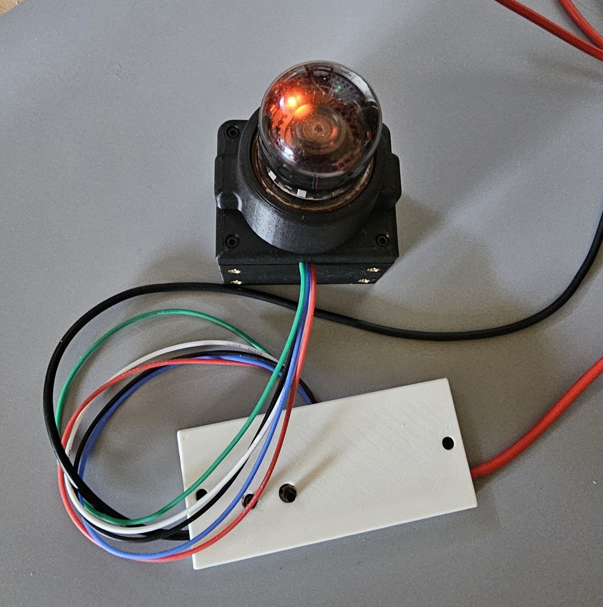
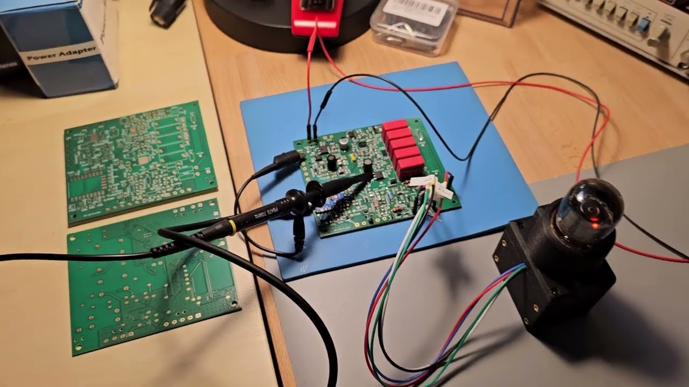
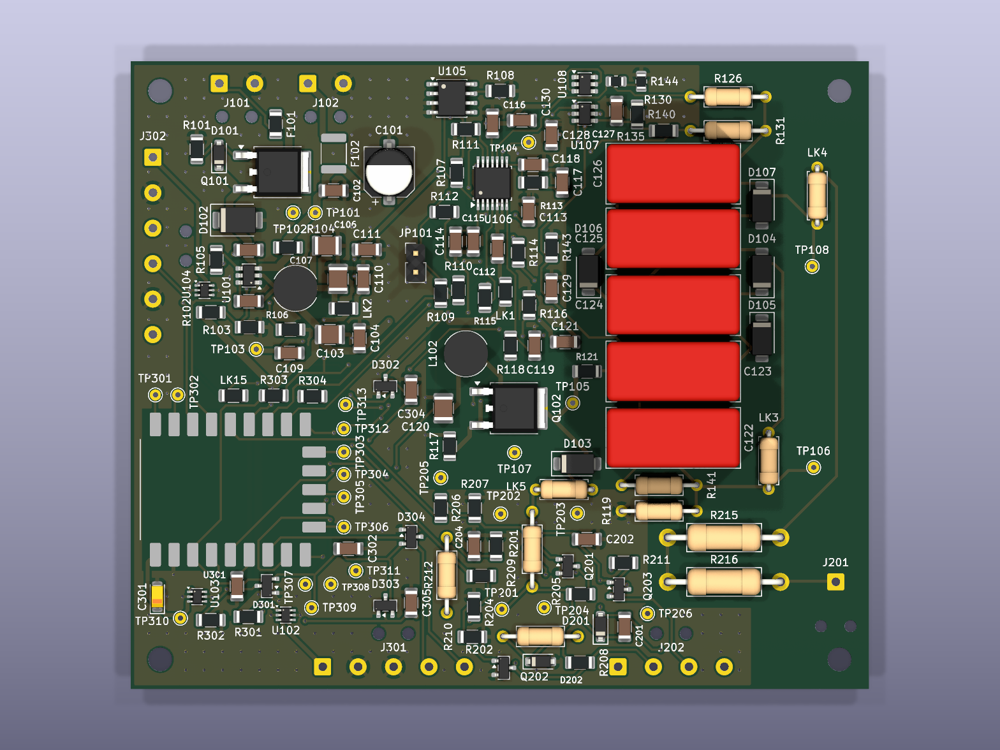
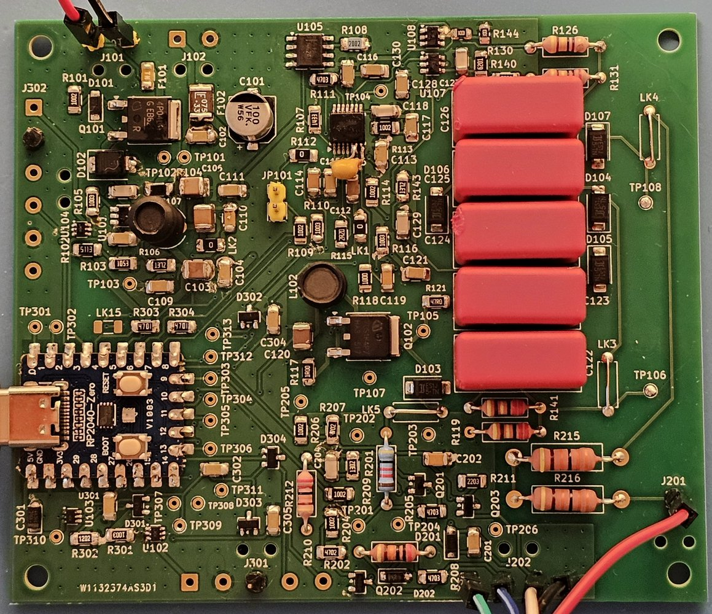
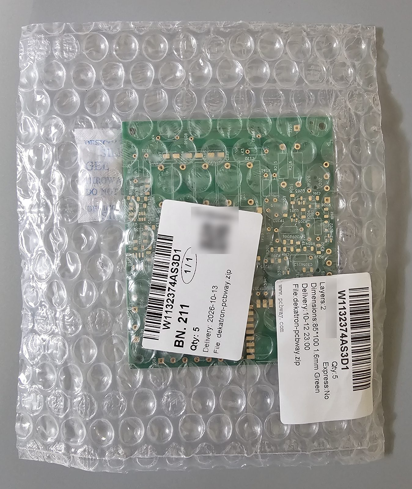

# universal-nixie-display

A programmable desktop display: six IN-14 Nixie tubes in a row, one A101 dekatron, a 2.8" ESP32
touchscreen and a rotary encoder, in a matte PLA enclosure on a tilt base. It is meant to be an
enjoyable object on its own (clock, timer, demo) and a numeric output device for a computer,
Raspberry Pi or experiment, driven over USB serial with a small SCPI-style command set.

**Companion site:** [kuvychko.github.io/universal-nixie-display](https://kuvychko.github.io/universal-nixie-display/)
· **Interactive explainer:** [How a dekatron counts](https://kuvychko.github.io/universal-nixie-display/how-it-works/dekatron/)

## The dekatron on the bench

The first tube to run is the A101, on a bench fixture: a printed housing for its socket, a shroud
over the tube, and a white clamshell around a perf board with a resistor divider and two step
buttons ([bench test](docs/bringup.md#optional-a101-bench-test)). It strikes, holds its glow and
steps reliably in both directions; the video shows it stepping from a 400 V supply.

 <a href="https://youtube.com/shorts/yVVf5zhSL-M"></a>

*The bench fixture running from a 400 V supply (2026-10-20), and a still from the
[video](https://youtube.com/shorts/yVVf5zhSL-M) of the tube stepping (2026-10-19).*

The socket housing and shroud are not just for the bench: they go into the finished display as
they are, with the dekatron held horizontally, its end facing the viewer. The M3 inserts in the
housing's side faces are its mounting points in the enclosure. Print files and hardware are in
[enclosure/](enclosure/README.md#dekatron-bench-test-a101-bench-test-fixture).

## The dekatron on its own board

On 2026-10-25 the A101 ran from the first assembled controller/PSU board: the board's own HV
converter, bias supplies and guide drivers, with the RP2040 stepping the glow and counting its
passes over the index cathode. The video shows a demo loop: glow held still, slow rotation both
ways, speeding up to 200 steps/s, and a back-and-forth swing
([`tools/dekatron_demo.py`](tools/dekatron_demo.py), on the
[bring-up firmware](firmware/dekatron-bringup/README.md)). Stepping runs of up to 200 steps/s
in both directions counted every index pass exactly. With the tube lit the converter first held
only about 415 V of its 451 V setpoint; noise at the current-sense pin was ending its cycles
early. Since 2026-10-26, after three small reworks with kit parts, it regulates at the setpoint
with the tube lit ([assembly log](characterization/dekatron/2026-10-24_assembly_log.md)).

<a href="https://youtu.be/51U_WKXrzoA"></a>

*The first controller/PSU board driving the A101
([video](https://youtu.be/51U_WKXrzoA), 2026-10-25).*

## Status

**Phase 1D — dekatron controller/PSU bring-up** (boards from PCBWay received 2026-10-15; parts
from Mouser 2026-10-16). Schematics, simulations, PCB and fab files are done; the board is now being
assembled and brought up section by section. The planning baseline is
[docs/project_plan.md](docs/project_plan.md); the design decisions and open items are tracked in [docs/hardware.md](docs/hardware.md#dekatron-controllerpsu).

| Phase | Deliverable | State |
|---|---|---|
| 1A | Dekatron board architecture and power budget for 12 VDC input | Done |
| 1B | Hierarchical schematics and simulation evidence | Done (open simulation items in `docs/hardware.md`) |
| 1C | Dekatron controller/PSU PCB, BOM, fab files | Done: boards and parts received |
| 1D | Sectional bring-up and standalone firmware | **In progress** |
| 2 | Nixie PSU qualification and six-tube controller/mount | Not started |
| 3 | ESP32 UI, encoder, I2C master, USB host commands | Not started |
| 4 | Enclosure | Not started |
| 5 | Rev A release | Not started |

### Dekatron controller/PSU at a glance

Readable without KiCad. Board as fabricated (commit f4fd414, ordered 2026-10-09); the schematic
title block still reads "Rev A draft". **Not yet fully validated:** bring-up is in progress
(Phase 1D); on board 1 the HV supply and tube drive run, the HV at its setpoint under load after
reworks to the current sense and switching frequency ([docs/bringup.md](docs/bringup.md)).

| What | File |
|---|---|
| Schematic (PDF, 4 sheets) | [hardware/dekatron/docs/dekatron-schematic.pdf](hardware/dekatron/docs/dekatron-schematic.pdf) |
| Board renders | [top](hardware/dekatron/docs/dekatron-pcb-top.png), [bottom](hardware/dekatron/docs/dekatron-pcb-bottom.png) |
| Bill of materials | [hardware/dekatron/bom.csv](hardware/dekatron/bom.csv) |
| Assembly checklist | [hardware/dekatron/assembly.md](hardware/dekatron/assembly.md) |
| Gerbers and drill files | [hardware/dekatron/fab/](hardware/dekatron/fab/README.md) |
| Bring-up results | [docs/bringup.md](docs/bringup.md) |

 

*Render and board 1 as assembled by hand (2026-10-27). The yellow disc capacitor beside U106 is a
bring-up rework: 470 pF at the converter's current-sense pin.*

## Architecture

```
 12 VDC adapter ──┬──────────────► purchased Nixie HV module (~170-180 V) ──► Nixie controller/mount
                  │                                                           (6× IN-14, 6× K155ID1, RP2040-Zero)
                  └──► dekatron controller/PSU ──► A101 (HV, bias, guide drive, index sense, RP2040-Zero)
                         │ 5 V buck out
                         ▼
                   ESP32 2.8" display board ◄── USB-C to host (SCPI-style serial)
                   (UI, encoder, presets, I2C master)
                         │ I2C, 3.3 V
                         └──► dekatron controller, Nixie controller
```

The ESP32 owns *what* is displayed; the RP2040 controllers own time-sensitive sequences and
hardware state. See [docs/architecture.md](docs/architecture.md).

## Documentation

| Document | Contents |
|---|---|
| [docs/project_plan.md](docs/project_plan.md) | Planning baseline: scope, decisions, phases and acceptance gates |
| [docs/architecture.md](docs/architecture.md) | Power distribution, board boundaries, ownership |
| [docs/hardware.md](docs/hardware.md) | Electrical design, open decisions, harness tables |
| [docs/i2c_protocol.md](docs/i2c_protocol.md) | Versioned controller command/status contracts |
| [docs/host_interface.md](docs/host_interface.md) | USB serial / SCPI-style host contract |
| [docs/bringup.md](docs/bringup.md) | Module bring-up procedures and acceptance results |
| [docs/development.md](docs/development.md) | Toolchains, KiCad workflow, generated-file policy |
| [docs/references.md](docs/references.md) | Datasheets, source designs, attribution and reuse terms |
| [docs/companion_site.md](docs/companion_site.md) | Plan for the companion website (`website/`); the published site is [here](https://kuvychko.github.io/universal-nixie-display/) |

## Repository layout

| Path | Contents |
|---|---|
| `hardware/dekatron/` | Dekatron controller/PSU KiCad project; `simulation/` holds supply and drive/sense models |
| `hardware/nixie/` | Nixie controller/mount KiCad project (planned, Phase 2) |
| `hardware/power/` | Purchased Nixie PSU specification and system power harness (planned, Phase 2) |
| `hardware/lib/` | Shared symbols and footprints (planned; the dekatron board's own library is in `hardware/dekatron/lib/`) |
| `firmware/display/` | ESP32 main application, PlatformIO (planned, Phase 3) |
| `firmware/dekatron/` | RP2040 dekatron controller and standalone diagnostics (planned, Phase 1D) |
| `firmware/nixie/` | RP2040 Nixie controller (planned, Phase 2) |
| `firmware/common/` | Shared protocol definitions (planned) |
| `enclosure/` | Printed parts, one folder per assembly (SOLIDWORKS source, STEP, 3MF); index and print settings in its README |
| `tools/` | KiCad generators (schematic, placement, routing, silkscreen) and the site checker; serial client and bring-up scripts to come |
| `characterization/` | Dated measurements: supply, homing, thermal, reliability (none yet) |
| `tests/` | Host protocol/formatting tests, hardware test scripts (planned) |
| `website/` | Companion site source (MkDocs Material; `mkdocs.yml` at the root) |

## Safety: read this first

> [!WARNING]
> **This project uses dangerous voltages.** The dekatron runs from about 450 V DC and the Nixies
> from about 170-180 V DC. A shock at these voltages can cause serious injury or death, and
> capacitors can hold a charge after the power is off. If you build, test or copy anything here,
> you do so **entirely at your own risk**. Work on it only if you understand high-voltage
> circuits and know what you are doing. The designs and documents are provided as is, without
> warranty of any kind (see [LICENSE](LICENSE)).

The **A101 bench test** ([docs/bringup.md](docs/bringup.md#optional-a101-bench-test);
[video](https://youtube.com/shorts/yVVf5zhSL-M)) is the most
exposed part of the project: open wiring on a perf board, the anode at up to 450 V and every other
wire at 50-106 V, none of them at ground. If you try it:

* **One hand.** While anything is powered, keep one hand away from the circuit, for example in a
  pocket. Operate buttons by their insulated caps.
* **Limit the current.** Use a bench supply with an adjustable current limit, set to a few
  milliamps (2-3 mA for the bench test).
* **Power off to touch.** Make and change connections only with the supply off and its output
  discharged; measure before you touch anything.
* **Rated equipment.** Use meters, probes and leads rated for the voltage. Clip leads on before
  powering up rather than holding probes on live nodes.
* **Not alone, not tired.** Work with someone nearby, and stop when you are not concentrating.

On the boards, discharge paths, clearances and probe ratings are design requirements, not
afterthoughts (project plan §4). Printed plastic parts keep fingers away; they are not
high-voltage insulation.

## Acknowledgements

The dekatron controller/PSU boards were made by [PCBWay](https://www.pcbway.com/), who
sponsored their fabrication. Ordering was easy and smooth: upload the Gerber zip from
[`hardware/dekatron/fab/`](hardware/dekatron/fab/), pick the options and go. What stands out is
how much information their website gives, from exactly what you are ordering to where your order
is in production. There is even a full walk-through of how a board is made, step by step:
[PCB manufacturing process](https://www.pcbway.com/pcb-service.html). Beyond bare boards they
also make SMD stencils and offer assembly, CNC machining and 3D printing.

The Gerbers went up on the evening of 2026-10-08 and the five boards were on the bench on
2026-10-15. They came sealed in bubble wrap with a silica-gel desiccant pack, and the label lists
the order, the uploaded file, size, layer count, thickness and quantity. The edges are milled
clean: no break-away tab remnants to file, so the boards were ready to use straight out of the bag.

Thank you, PCBWay, for supporting an open-source hardware project!

 

## Licence

Hardware, enclosure, documentation and the companion site's content: CERN-OHL-P v2. Firmware,
tools, tests and the site's JavaScript: MIT. See [LICENSE](LICENSE).
