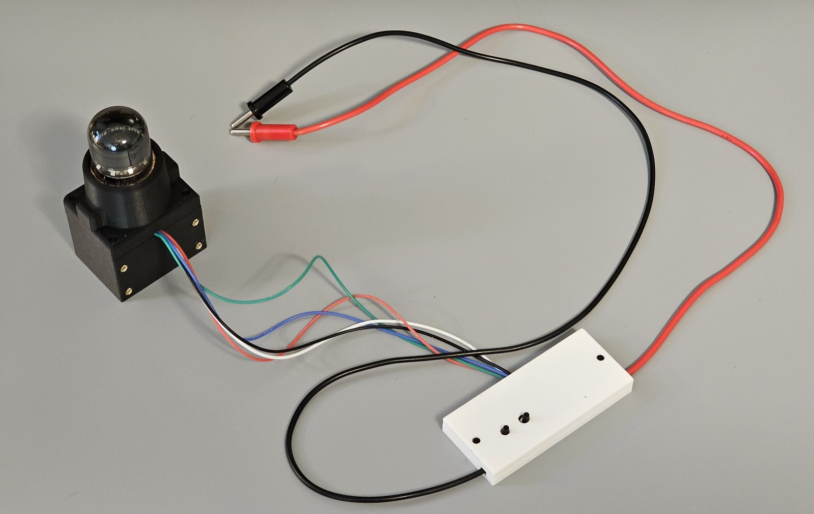
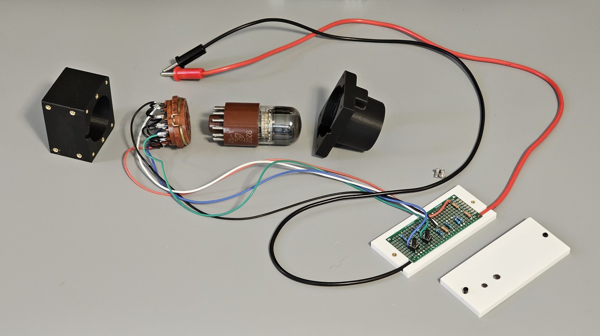
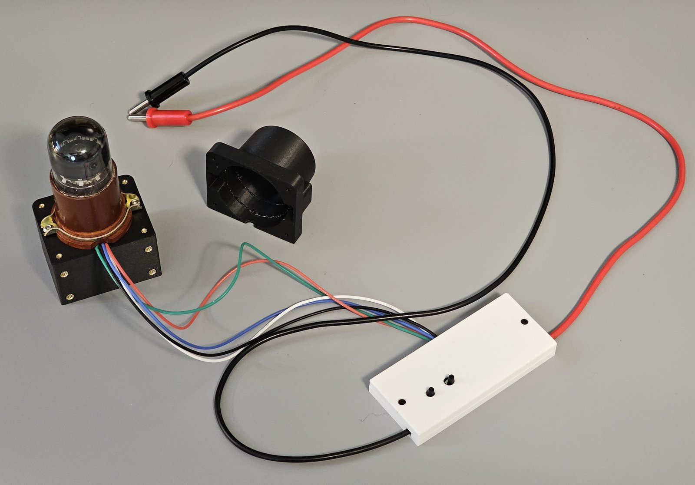
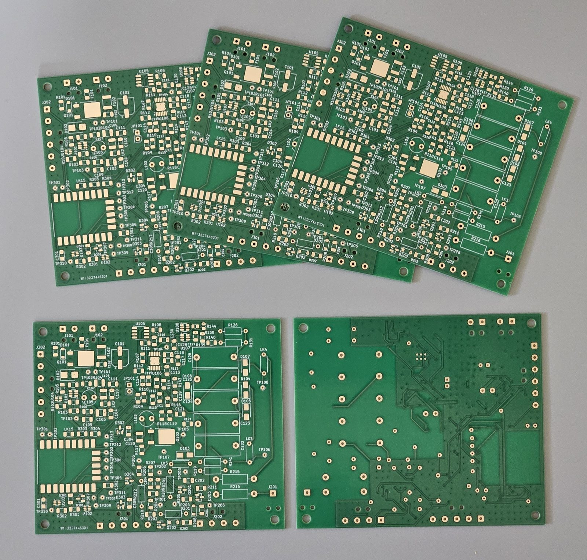

# Build and investigate

The design is open: hardware under CERN-OHL-P v2, firmware and tools under MIT. Everything lives
in the [project repository](https://github.com/kuvychko/universal-nixie-display). This site explains; the repository documents.

| Where | What |
|---|---|
| [Project plan](https://github.com/kuvychko/universal-nixie-display/blob/main/docs/project_plan.md) | Scope, phases and acceptance gates |
| [Architecture](https://github.com/kuvychko/universal-nixie-display/blob/main/docs/architecture.md) | Power distribution, boards and who owns what |
| [Hardware design](https://github.com/kuvychko/universal-nixie-display/blob/main/docs/hardware.md) | Electrical design, decisions and their sources |
| [Bring-up and bench results](https://github.com/kuvychko/universal-nixie-display/blob/main/docs/bringup.md) | Test procedures and measurements, including the A101 bench test |
| [Dekatron board](https://github.com/kuvychko/universal-nixie-display/tree/main/hardware/dekatron) | KiCad project, simulations and fabrication files |
| [Enclosure](https://github.com/kuvychko/universal-nixie-display/tree/main/enclosure) | Printed parts and print settings |

!!! warning "The A101 socket is rare"
    A101 dekatrons are easy to find, on eBay for reasonable money, but their original socket
    (PL30-2p, ПЛ30-2п) is not: this build uses one already on hand, and none could be found for
    sale. To reproduce the display, plan on a different or custom socket. It must keep the tube's
    pinout and keep the anode wire well away from the others; the printed socket housing would
    need redesigning to match. A promising route, not yet tried here, is a
    [3D-printable PL30-2p socket](https://www.printables.com/model/1337925-dekatron-nixie-tube-socket-pl30-2p-for-a-101-a-102) on Printables; if it is printed, the anode pin's
    clearance to its neighbours should come from air gap and rated wire, not from the plastic.

## The A101 bench fixture

The tube was first tested on a bench circuit before the controller board existed (see
[How a dekatron counts](how-it-works/dekatron.md#the-circuit-on-the-bench)). The fixture is three
printed parts: a white clamshell around the perf board with the resistor divider and the two
step buttons, a black housing that holds the A101's socket, and a shroud over the tube. The shroud
covers the pins even if the tube is partly pulled out of its socket, and gives the fixture one
colour, smooth lines and no visible hardware. The tube itself dissipates very little power (about
42 mW on the bench: 147 V at 288 µA), so ordinary PLA is fine. The parts are held together with
brass threaded inserts and M2/M3 machine screws; the print files and hardware list are in the
[enclosure folder](https://github.com/kuvychko/universal-nixie-display/tree/main/enclosure#dekatron-bench-test-a101-bench-test-fixture).

*The assembled bench fixture, photographed 2026-10-18 (tube unlit).*

*Taken apart, left to right: socket housing, PL30-2p socket, A101, shroud, and the clamshell
opened to show the perf board.*

*Shroud off: the socket's bracket is screwed to the housing, and the shroud fits over the tube.*

!!! danger "High voltage, at your own risk"
    The display generates about 450 V for the dekatron and about 170-180 V for the Nixies, which
    can cause serious injury or death. Anything you build from this project is at your own risk.
    Read the [safety notes](safety.md), and the precautions in the build documents, before building
    or probing anything.

!!! info "Status"
    Phase 1 (dekatron controller and power supply) is in bring-up: boards and parts are
    in hand, and the tube is bench-tested. A full build guide will follow a working, tested
    instrument.

*The dekatron controller/PSU boards as received from PCBWay, 2026-10-15: 100 × 85 mm, two layers,
not yet assembled.*
