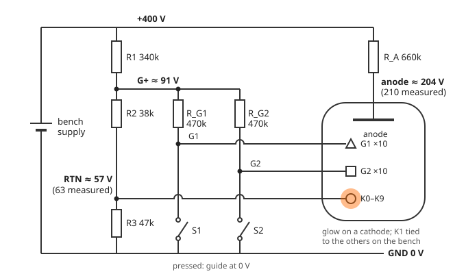
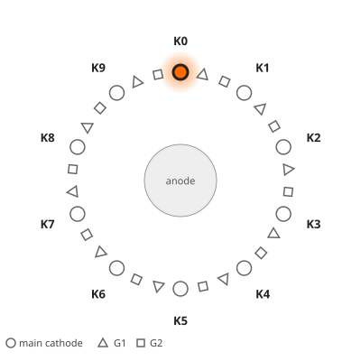
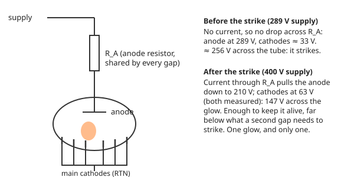

# How a dekatron counts

A dekatron is a gas-filled glass tube with a ring of ten cathodes around a central anode. One
spot of glow, orange in a neon tube like this project's A101, sits on one cathode. Send the tube a pair of pulses and the spot moves one
place round the ring; send them in the other order and it moves back. The position of the spot is
a decimal digit.

That makes the dekatron unusual among display tubes: it does not just **show** a number, it
**holds** one. It is a counter, a one-digit memory and a display in one envelope. This page
explains how a glow can do that, using the A101, the two-guide dekatron in this project.

The page answers five questions:

1. Why does only one main cathode glow, when all of them are connected to the circuit?
2. How can pulsing a whole group of guides select only the guide beside the glow?
3. Why does the glow move on to the next main cathode rather than back to the old one?
4. Why does reversing the pulse order reverse the count?
5. What keeps the count between pulses?

## The circuit on the bench

Everything on this page is explained with the circuit the project's A101 was first tested on: a
bench supply, a few resistors and two pushbuttons. **All voltages are measured from ground**, the
supply's negative terminal, so a number always means the same thing.

!!! danger "Not a casual experiment"
    This circuit has 400 V on open wiring. If you build anything like it, it is at your own risk:
    read the [safety notes](../safety.md) first, and keep one hand away while it is powered.

[{ .figure-plate }](../assets/bench-circuit.svg)

*The bench circuit (open the drawing full size). The parts are the ones used on the bench.*

- The **anode** is fed from the 400 V supply through one resistor, R_A.
- All ten **main cathodes** return to **RTN**, which the divider R1-R2-R3 holds at about 57 V
  rather than at ground. That is the trick that lets a plain switch to ground pull a guide
  *below* the cathodes.
- All ten **G1** guides are joined, and so are all ten **G2** guides. Each set is pulled up through
  470 kΩ to **G+**, about 91 V, which keeps the guides above the cathodes at rest. Pressing **S1**
  grounds every G1 at once; **S2** grounds every G2.

The node voltages in each state, calculated from the resistor values:

| Buttons | Glow on | Cathodes (RTN) | G+ | Pressed guide | Anode |
|---|---|---|---|---|---|
| None | a main cathode | 57 V (63 V measured) | 91 V | — | 204 V (210 V measured) |
| S1 | a G1 | 39 V | 70 V | 0 V | 147 V |
| S1 and S2 | a G1 and a G2 | 34 V | 62 V | 0 V | 147 V |
| S2 | a G2 | 39 V | 70 V | 0 V | 147 V |

The calculation treats the tube simply: the anode sits 147 V, the tube's measured maintaining
voltage, above whichever electrode glows. Where the bench was measured, it comes out about 6 V
low. Notice that the cathodes move too. The divider is not stiff, and while the glow sits on a
grounded guide the tube current no longer flows into RTN, so RTN falls. The controller board
uses the same scheme with transistors in place of the buttons, but regulates RTN, so there the
cathodes stay put.

## Step through it

The ring below is drawn from above. Between each pair of main cathodes (circles, K0-K9) sit two
**guides**: a G1 (triangle) and a G2 (square). All ten G1 guides are wired together, and so are
all ten G2 guides: the circuit has only two guide wires, one per button.

Use **Stage ▶** to follow one handoff at a time, or **Count +1** to complete a whole step. With
the ring focused, the left and right arrow keys move one stage and the up and down keys one count.
Under the ring, a voltage record of the bench circuit builds up like a scope trace, in volts from
ground, with the cathodes dashed underneath each trace. Count up a few times, then down, and
compare the order in which G1 and G2 fall.

*The interactive figure needs JavaScript. Here is the ring at rest, with the glow on K0, and the
sequence that moves it one step:*

{ .figure-plate width="400" }

| Stage | G1 guides | G2 guides | Glow on |
|---|---|---|---|
| Rest | at rest | at rest | K0: count = 0 |
| 1 (S1) | grounded | at rest | G1 beside K0 (transfer in progress) |
| 2 (S1, S2) | grounded | grounded | spreading from that G1 to the next G2 |
| 3 (S2) | at rest | grounded | G2 beside K1 |
| Rest | at rest | at rest | K1: count = 1 |

Starting with G2 instead runs the same stages backwards and counts down.

!!! note "What the figure is, and is not"
    A qualitative state model, slowed down enormously, not a plasma simulation. The halo is
    schematic, and each stage in the real circuit is far shorter than shown. The drawing's electrode
    order and viewing direction are illustrative until checked against the A101 itself. The drive
    sequence is the bench test's button sequence, which stepped the tube reliably both ways.

## Why only one glow

A glow discharge needs a high voltage to **strike** (start) across a gap, and a lower one to
**sustain** it once the gas near the cathode is ionised. All the tube's cathodes share one
anode, and the anode is fed through one resistor.

{ .figure-plate }

Before anything conducts, no current flows through the resistor, so the anode sits at the full
supply voltage. On the bench the tube struck as the supply reached 289 V, with the cathodes at
about 33 V (calculated): about 256 V across the tube. From then on the current through R_A drops the anode
until only the **maintaining voltage** is left across the glow: at a 400 V supply the anode
measured 210 V and the cathodes 63 V, so 147 V. That is plenty to keep the existing glow alive, and
far below the roughly 256 V a fresh gap needs. No second glow can start, and the tube settles
into one lit cathode by itself. Almost always: the A101's datasheet warns that just after
switch-on two cathodes may glow at once, until a reset pulse clears one.

## How the glow moves

At rest the guides sit at G+, about 91 V, above the main cathodes at about 57 V, so the glow has
no reason to visit them. To move it, a button grounds one set of guides: 0 V, well below the
cathodes.

All ten G1 guides fall together, but they are not all equal. The one beside the glow sits in a
cloud of ions and excited atoms left by the discharge, and a discharge starts there far more easily
than at a guide across the ring. So the glow hands over to the **adjacent** guide only. This is
a local handoff: the glow grows on the new electrode as it fades on the old one. Nothing travels
round the tube.

The presses overlap. While S1 is still held, S2 grounds G2 too, and the glow spreads to the G2
beside it. That G2 is on the far side of the G1 from the old cathode: the G2 on the old cathode's
other side is two electrodes away and out of reach. Then G1 is released, leaving the glow on G2,
and finally G2 is released. The glow falls to the nearest main cathode, which is now the **next**
one. The two guides between each pair of cathodes act like a ratchet: the order of the pulses
decides which way the glow can go.

**Reverse the order** (S2 first, then S1) and the same reasoning runs the other way round the ring:
the count goes down. The same two buttons drive the count in both directions.

### Unrolled: the voltages that decide it

Cut the ring open and lay a few electrodes out in a row under the anode. The chart below them is
in volts from ground, the same numbers as the table above. Each electrode's bar runs from its own
voltage (the dot) up to the anode's (the solid line), so **the bar's length is the voltage across
its gap**. Two marks on each bar give this tube's measured limits: the tick, 147 V above the
electrode, is what **keeps a glow going**; the dashed outline, about 256 V above it, is what fresh
gas needs to **start one**. A gap next to the glow is **primed** by its ions and starts at a lower
voltage (the arrow); by how much was not measured, so the figure gives no number for it.

Because the anode sits 147 V above whichever electrode glows, it follows the glow. When the glow
moves onto a grounded guide, the anode drops to 147 V, and the cathode the glow left behind no
longer has enough voltage across it to stay lit.

Each change is shown twice: **the instant the buttons change**, before the glow has moved, and
**after the handoff**.

*The interactive figure needs JavaScript. One step from K0 to K1, in volts from ground (gap = anode
minus electrode):*

| Moment | Anode | Cathodes | What the gaps see | Result |
|---|---|---|---|---|
| At rest on K0 | 204 V | 57 V | Other cathodes 147 V (sustains, cannot strike); guides at 91 V, 113 V | Glow stays on K0 |
| S1 pressed, instant | 198 V | 51 V | Every G1, now at 0 V, has 198 V: below 256 V, but the G1 beside K0 is primed | Only that G1 strikes |
| After | 147 V | 39 V | K0 is left with 108 V, below 147 V | K0 goes out |
| S2 pressed too | 147 V | 34 V | G2 at 0 V has 147 V; the one beside the glow is primed | Glow spreads onto it |
| S1 released | 147 V | 39 V | G1 rises towards 70 V: 77 V across it | G1 goes out; glow on G2 |
| S2 released, G2 passing 57 V | 204 V | 57 V | K0 and K1 both have 147 V; only K1 is next to the glow | Glow lands on K1 |
| After | 204 V | 57 V | G2, back at 91 V, has 113 V | Count = 1 |

!!! note "A first-order picture"
    The two limits are measured; the node voltages are calculated from the bench circuit with the
    simple anode rule, and come out about 6 V below the two points that were measured. While a
    released guide carries the glow, it rises only as fast as its 470 kΩ pull-up allows; the
    figure shows it at the moment it passes the cathodes. Real gaps also differ in geometry, and
    the ions' influence fades with distance rather than stopping at the neighbouring electrode.
    The figure shows why the handoff is selective, not how fast it happens.

## How fast it can count

Slowly. The A101 is rated at 1,000 steps per second, at the slow end of what dekatrons could
do. That is no handicap here: the display's plan steps it at up to 200 per second.

What sets the limit is the same thing that makes the handoff work. Every transfer leaves ions and
excited atoms around the electrode the glow has just left. They are what primes the neighbouring
gap, and they take time to clear: step again too soon and the old position is still primed, so
the glow can take the wrong neighbour. Ericsson's 1954 catalogue, describing one of its tubes,
names the limit as the de-ionisation time of the gas.

So the gas fill sets the speed. The table collects the tubes whose figures could be traced to a
datasheet, a manufacturer's bulletin or Acton's account; a dash means the source does not say.

| Tube | Fill | Glow | Maintaining voltage | Rated speed | Source |
|---|---|---|---|---|---|
| A101 (Soviet; this project) | neon | orange (this project's bench) | 130–170 V | 1 kHz (0.01–1000 Hz) | Original datasheet, 1989[^a101] |
| Ericsson GC10B | neon and helium | — | — | 4 kHz | Acton[^acton] |
| Raytheon CK7978 | neon | — | 190 V (nominal tube drop) | 5 kHz | Raytheon datasheet, 1961[^ck7978] |
| A106 (Soviet) | "a neon mixture" | blue | 255–295 V | 10 kHz (10⁴ Hz) | Soviet handbook page[^a106] |
| Ericsson GC10D | helium and hydrogen | — | — | 10–20 kHz, by drive waveform; up to 40 kHz by Acton's account | Acton[^acton]; collectors' survey[^ia] |
| A107 (Soviet) | — | light blue | 270–310 V | 1 MHz (0.01 Hz–10⁶ Hz) | Soviet handbook page[^a107] |
| Elesta EZ10B (Switzerland, 1961) | — (collectors: hydrogen[^tt]) | "weaker, bluish" | about 290 V (half its 580 V supply) | "a little above 1 MHz" | Elesta technical bulletin No. 17, 1961[^ez10b] |

Two patterns stand out. The slow tubes are the neon ones with the familiar orange glow; the fast
ones glow blue. And the fast ones need about twice the A101's maintaining voltage. Their makers'
own sheets mostly do not name the gas: the A107's is silent, and Elesta's bulletin describes the
EZ10B's speed and glow but not its fill. Collectors' sources say hydrogen for the 1 MHz class, and
Elesta concedes the price in light: the EZ10B's glow is weaker. Reaching 1 MHz took more than the
tube, too: the bulletin gives a dedicated input stage for it, more critical to build and set up
than its 500 kHz trigger.

!!! warning "Ten times too fast: one tube, three sources"
    The A106's handbook page gives its speed as 10⁴ Hz: 10 kHz. The collectors' site Lampes et
    tubes transcribes this as "104 Hz", the exponent lost. A third source, Industrial Alchemy,
    rates the tube at 100 kHz, ten times the handbook. The fill is no clearer: the handbook says "a neon
    mixture", which cannot by itself explain a blue glow (neon glows orange-red), while Lampes et
    tubes says argon, whose glow is violet-blue. The table uses the handbook. Collectors' surveys
    also list a few 100 kHz types, the Sylvania 6909 and 8035 and the Raytheon 8262; without a
    datasheet to check them against, they are left out of the table.

Speed had a price beyond the voltage. Hydrogen seeps out through the glass, even on the
shelf, and helium-filled GC10Ds have almost always lost their gas by now[^ia]. Neon was the
stable choice, and most dekatrons ran far below the hydrogen tubes' speeds. For faster inputs, the
answer at the time was to put vacuum-tube counting stages in front: for one of its tubes,
Ericsson's catalogue advises vacuum-tube decades ahead of the dekatron above about 20,000 counts
per second. Transistor counters later made the whole arrangement obsolete.

## A tube that remembers

Between steps, nothing in the drive circuit records the count. Both guide wires sit at rest,
identical for every digit. **The count exists only as the position of the glow**, and the
discharge keeps itself there: the anode-resistor balance above holds it on whichever cathode it
occupies. The pulses carry no number, only "one more" or "one fewer".

In the finished display the point is literal. On the controller board, nine of the ten main
cathodes are joined together at the socket and return on one wire; only K1, the **index** cathode, has a wire of its own (turn on
*Show connections* in the figure). The controller cannot ask the tube which digit it holds. It can
only see the index light once per revolution and count the pulses it has sent since. The tube is
the only place where the count actually lives.

The memory is volatile. It lasts exactly as long as the discharge: switch off and the count is
gone, and at the next power-up the glow strikes wherever it strikes. That is why a dekatron circuit
needs the index cathode, or a reset, to find a known starting point.

Engineers in the 1950s used exactly this as computer memory. The Harwell Dekatron computer kept
its numbers in 720 dekatrons, each one a decimal digit you could watch.

The memory has one more quirk: it does not like to sit still. A glow left on one cathode for a
long time changes the tube: Ericsson's 1954 catalogue warns that the GC10B's maximum speed drops
if the glow rests on one cathode for more than 2,000 hours. The A101's datasheet allows at
most an hour of running slower than one step per 100 seconds, and after slow running (a step per
second or less) recommends twenty minutes of exercise at 100 steps per second or more. The
Harwell restorers met the same problem: dekatrons that had spent a long time with the glow on one
cathode became "sticky", and they planned a way to spin a whole store of them. A dekatron that
shows a fixed number for hours is, in the datasheet's terms, being misused. This display's
controller will therefore never hold the glow still for long: it exercises the tube now and then,
and switches it off when there is nothing to show.

## A short history

- **1945–1947.** John Reginald Acton, then at the valve maker Cossor, finds that a pulse can move a
  glow discharge from one cathode to another, and that it stays put when the pulse ends. A
  colleague wishes aloud for "a valve that has ten states built into it"; Acton imagines moving the
  glow along a line of ten cathodes.
- **1948.** At Ericsson Telephones in Beeston, Nottingham, Acton demonstrates a first prototype in
  November. By the end of the year the ten-way GC10A, filled with helium and counting up to about
  400 pulses per second, is ready for production.
- **1949–1950.** A provisional patent in Acton's name is granted on 18 January 1949. A colleague,
  Ray Bacon, suggests the name *Dekatron*, which appears in print in May 1950.
- **1950s.** The faster GC10B, filled with neon and helium (about 4,000 pulses per second), becomes
  the standard tube, used by the thousand in Geiger-counter scalers, timers, early calculators and
  cash registers. The helium-hydrogen GC10D goes faster still (see
  [How fast it can count](#how-fast-it-can-count)). The design is copied in Europe, the USA and
  the USSR.
- **1951.** The Harwell Dekatron computer, designed at Harwell from 1949, first runs. Its store is
  720 dekatrons. It works until 1973; restored at The National Museum of Computing, it is rebooted
  on 20 November 2012 and recognised in 2013 as the world's oldest original working digital
  computer.
- **Mid-1960s.** Transistor counters make the dekatron obsolete, and Ericsson stops making them.
  Equipment already installed lives on: dekatron timers still controlled spot welders at the end of
  the century.

The **A101** in this project is a Soviet two-guide dekatron with a ten-cathode ring and an index
output. Its product sheet comes from the Reflector plant and is stamped December 1989, late in the
dekatron's life; a fuller production history is still to be sourced.

## This build

The tube on this page is not hypothetical. On the bench (2026-10-09) the project's A101:

- struck at a 289 V supply, with about 256 V across the tube;
- held its glow at a maintaining voltage of 147 V, at 288 µA;
- stepped reliably in both directions with the guides grounded, about 63 V below the cathodes:
  less than half the 135–200 V control pulse its datasheet calls for.

The controller board uses the same scheme with the buttons replaced: RTN is regulated at about
50 V, and transistor switches driven by an RP2040 ground the guides, about 50 V below the
cathodes. It also gives the index cathode K1 a wire of its own, so the controller can sense it.
The details are in the engineering documents:
[bench test](https://github.com/kuvychko/universal-nixie-display/blob/main/docs/bringup.md#optional-a101-bench-test)
and [dekatron controller design](https://github.com/kuvychko/universal-nixie-display/blob/main/docs/hardware.md#a101-operating-point-d1).

## Sources

- John and Robin Acton, [Dekatron – The Story of an Invention](https://www.computerconservationsociety.org/resurrection/res61.htm),
  *Resurrection* 61, Computer Conservation Society. The invention, the GC10 tubes and their decline.
- The National Museum of Computing, [The Harwell Dekatron / WITCH](https://www.tnmoc.org/witch).
  The computer, its store and its restoration.
- [Ericsson 1954 Dekatron catalogue](https://electricstuff.co.uk/dekatron.html), transcribed on
  electricstuff.co.uk. Striking and maintaining voltage, glow transfer, guide sequencing and the
  de-ionisation limit, for Ericsson's tubes rather than the A101.

[^a101]: Reflector (Sovtek), A-101 product sheet, accepted December 1989 ([scan](https://www.tube-tester.com/sites/nixie/dat_arch/A-101_02.pdf) via tube-tester.com): counting rate 0.01–1000 Hz. The sheet gives neither fill nor maintaining voltage; those are from tube-tester.com's [A101 page](https://www.tube-tester.com/sites/nixie/datdekat/A101/A101.htm) ("Neon filled", 130–170 V). The glow colour is as seen on this project's bench: the classic orange of neon.
[^acton]: Acton, *Dekatron – The Story of an Invention* (above): GC10B "neon/helium mixture", 4,000 pulses per second; GC10D "Helium and Hydrogen", "up to 40,000 pulses per second".
[^ck7978]: Raytheon, *CK7978 Technical Information*, 15 January 1961: "cold cathode gas-filled 5 KC medium speed bi-directional ring stepping decade counter", "direct visual neon glow readout", input frequency 5000 cps, nominal tube drop 190 V. Copy via [Industrial Alchemy](https://www.industrialalchemy.org/articleview.php?item=764).
[^a106]: A106 handbook page (Soviet reference book): "Свечение — синее. Наполнение — смесь неона" (glow blue; fill a neon mixture); frequency 10⁴ Hz; maintaining voltage 255–295 V. Transcribed by [Lampes et tubes](https://lampes-et-tubes.info/cd/cd052.php?l=e) as "104 Hz", argon, violet-blue; rated 100 kHz by [Industrial Alchemy](https://industrialalchemy.org/articleview.php?item=1070).
[^a107]: A107 handbook page (Soviet reference book): "Цвет свечения — голубой" (light blue); counting rate 0.01–10⁶ Hz; maintaining voltage 270–310 V; life at least 1,000 hours. No fill given. [Scan](https://lampes-et-tubes.info/cd/A107.pdf) via Lampes et tubes.
[^ez10b]: Elesta AG, *Technische Mitteilungen* No. 17, February 1961, "Die Dekadenzählröhre EZ 10 B": "Zählfrequenzen von 1 MHz", a cut-off frequency "wenig über 1 MHz", "das schwächere bläuliche Glimmlicht", a 580 V supply "etwa zweimal so hoch wie die Brennspannung", and a separate input stage for 1 MHz. [Scan](https://lampes-et-tubes.info/cd/EZ10B.pdf) via Lampes et tubes; transcribed on [radiomuseum.org](https://www.radiomuseum.org/tubes/tube_ez10b.html).
[^tt]: tube-tester.com, [EZ10B](https://www.tube-tester.com/sites/nixie/datdekat/ez10b/ez10b.htm): "Hydrogen filled"; Industrial Alchemy also gives hydrogen.
[^ia]: Industrial Alchemy, [Dekatron glow-transfer counting tubes](https://www.industrialalchemy.org/tubepage.php?item=15): a collector's survey of dekatron types, including the GC10D's 20 kHz rating with sine-wave drive and 10 kHz with square pulses, hydrogen's leakage through glass, and the GC10D's lost helium.
