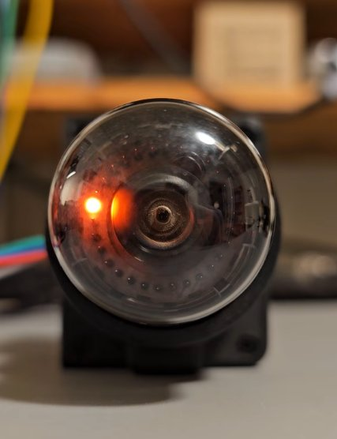

# Universal Nixie Display

Six IN-14 Nixie tubes in a row, one A101 dekatron and a small touchscreen, in a desktop
enclosure. It is a clock, a timer and a toy on its own, and a numeric display for a computer or an
experiment over USB.

[{ width="300" }](https://youtube.com/shorts/yVVf5zhSL-M)

*The project's A101 dekatron stepping on the bench, from a 400 V supply
([watch on YouTube](https://youtube.com/shorts/yVVf5zhSL-M), recorded 2026-10-19). How it works,
with a ring you can step yourself: [How a dekatron counts](how-it-works/dekatron.md).*

**How can a glow in a gas-filled tube display a number, or remember and count one?**

The two kinds of tube answer that question in opposite ways. A **Nixie** is stateless: it lights
whichever numeral its driver selects, and forgets it the moment the drive changes. A **dekatron**
is stateful: a spot of glow sits on one of ten cathodes, and pulses move it one place round the
ring, forwards or backwards. The position of the glow *is* the number, and the tube holds it by
itself between pulses. One tube shows a number; the other remembers one.

!!! danger "High voltage"
    The tubes run at 170-450 V DC, which can cause serious injury or death. Anything you build or
    try from this project is at your own risk: read the [safety notes](safety.md) first.

## Two ways in

**[Explore the display](display.md).** What the finished instrument does, its controls and its
modes, as they become real.

**[Understand the tubes](how-it-works/dekatron.md).** Start with the dekatron: an interactive
ring you can step through, why only one glow can exist, how it moves, the bench circuit that
drives it, how fast it can count, why the tube is a memory, and a short history. Then
[the Nixie](how-it-works/nixie.md).

!!! info "Status"
    The display is under construction. The dekatron controller and power-supply boards are
    made and now being brought up, and the A101 dekatron has been bench-tested: it strikes,
    holds its glow and steps reliably in both directions (the video above). The Nixie side comes
    next. See [Build and investigate](build.md).
